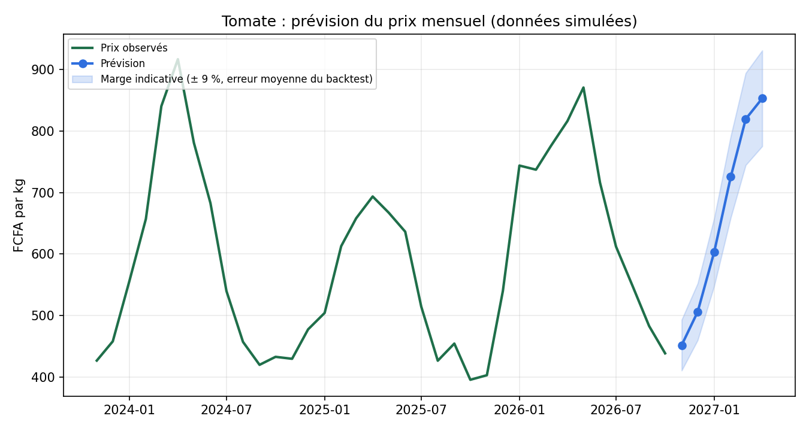

# Prévision des prix agricoles (maïs, tomate, igname)

Projet 100 % Python de prévision de séries temporelles : il compare plusieurs modèles par **backtest**, choisit le meilleur et prévoit les prix des prochains mois, avec une marge d'erreur indicative.

> **Données simulées.** Les prix sont générés par `prix_agricoles/donnees.py` (tendance, saisonnalité, bruit, épisode de hausse en 2022). Ils servent à démontrer la méthode. Pour de vrais prix, fournir un fichier CSV avec les colonnes `date`, `produit`, `prix_fcfa_kg` et lancer `python main.py --donnees mon_fichier.csv`.



## Méthode

1. **Données** : séries mensuelles par produit (2016 à octobre 2026).
2. **Quatre modèles** de même signature :
   - *Naïf saisonnier* : le prix d'un mois est celui du même mois l'an dernier ;
   - *Moyenne mobile* : la moyenne des 3 derniers mois ;
   - *Régression Ridge* et *Forêt aléatoire* : ils apprennent la variation mensuelle du prix (en logarithme) à partir des variations récentes, de l'évolution sur un an et de la saison, puis prévoient mois après mois.
3. **Backtest** : sur les 24 derniers mois, on refait des prévisions à 6 mois en ne montrant au modèle que le passé. Mesures : MAE, RMSE et MAPE (erreur en %).
4. **Prévision** avec le meilleur modèle, tracée avec une marge égale à son erreur moyenne du backtest.

## Résultats (données simulées, prévisions à 6 mois)

| Produit | Meilleur modèle | MAPE | Naïf saisonnier | Forêt aléatoire |
|---|---|---|---|---|
| Maïs | Régression Ridge | 2,9 % | 7,3 % | 4,4 % |
| Tomate | Régression Ridge | 9,1 % | 13,4 % | 10,3 % |
| Igname | Régression Ridge | 4,4 % | 5,6 % | 5,6 % |

**À lire avec prudence :** comme les données sont simulées avec une tendance et une saison régulières, un modèle simple qui capte ces deux éléments gagne facilement. Ce résultat ne dit rien de la performance sur de vrais prix, où les chocs (météo, transport, politique) sont bien plus difficiles à prévoir.

## Utilisation

```
pip install -r requirements.txt
python main.py                        # 3 produits, 6 mois
python main.py --produit tomate --horizon 3
python -m unittest discover -s tests  # tests
```

Les résultats (tableaux de comparaison, rapport, graphiques) sont écrits dans `results/`.

## Structure

```
main.py                    ligne de commande
prix_agricoles/
  donnees.py               génération, chargement et mise en forme des séries
  modeles.py               les 4 modèles
  evaluation.py            backtest et comparaison
  graphiques.py            graphique de prévision
tests/test_prix.py         6 tests, dont un test d'absence de « fuite du futur »
data/  results/
```

## Pistes d'amélioration

- Utiliser de vrais prix (marchés béninois) et comparer les résultats
- Ajouter des variables externes : pluviométrie, prix du carburant, taux de change
- Tester d'autres modèles (SARIMA, gradient boosting) et des intervalles de prévision plus rigoureux
- Interface Streamlit pour choisir le produit et l'horizon

## Auteure

Fidélia EBA-DOVI, INSTI Lokossa. GitHub : [FideliaEBA](https://github.com/FideliaEBA)
